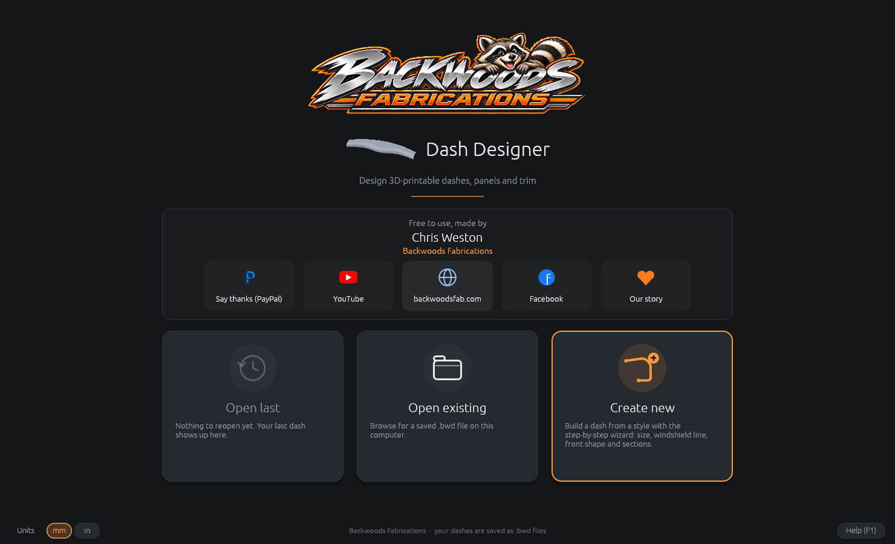
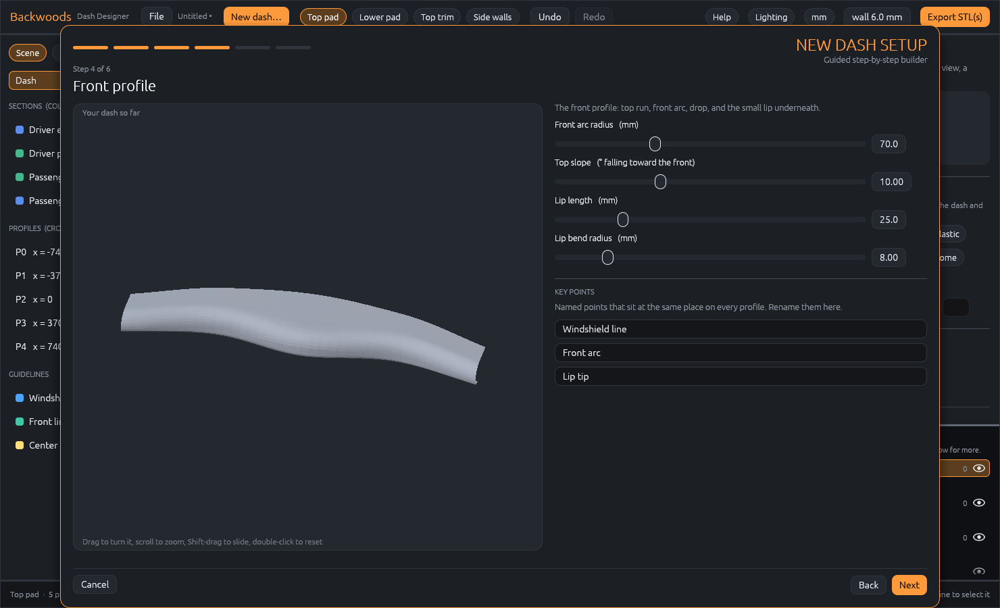
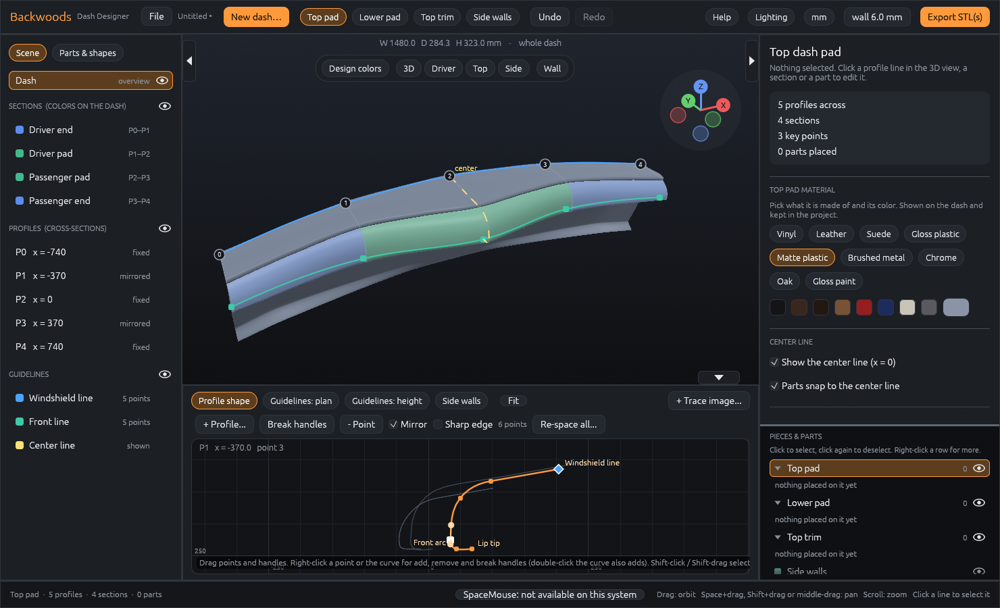
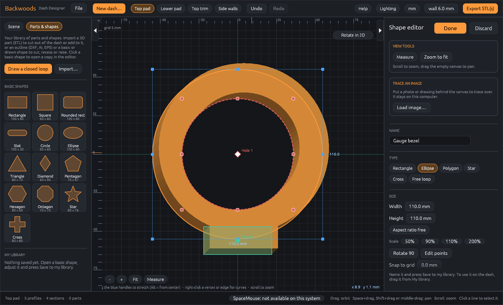
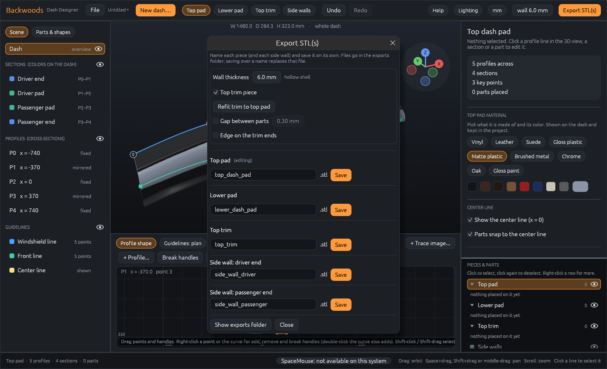

<p align="center">
  
</p>

<h1 align="center">Backwoods Dash Designer</h1>

<p align="center"><b>Design your own 3D-printable dash, panel or trim piece, on your own computer, for free.</b></p>

<p align="center">
  <a href="LICENSE"></a>
  
  <a href="https://www.youtube.com/@backwoodsfab"></a>
</p>

<p align="center">
  
</p>

---

## What is this?

Backwoods Dash Designer is a free program that helps you design the **dash of a car or truck**, or any panel or piece of interior trim, and then **turn it into files you can 3D print**.

You do not need to know CAD. You pick a starting style, tell it how big the dash is, shape the curves by dragging points on the screen, add things like gauge pockets, vents and speaker holes, and watch a live 3D picture of the dash change as you go. When you like what you see, one click saves the print files for your slicer.

It was built in our own Mid-Michigan garage for a classic car project, and we are sharing it so other builders, restorers and makers can use it too.

**It is for you if you:**

- are restoring or customizing a classic car or truck and need a dash, a console or a trim piece that nobody makes anymore
- have a 3D printer (or a friend or print shop that does) and want to make something that actually fits your vehicle
- want to try a custom design without learning professional CAD software first
- like tinkering and want a tool you can see inside of and change

## What can it do?

<table>
<tr>
<td width="50%" valign="top">
<br>
<b>Start with a guided wizard.</b> Pick a style (twin-pad, smooth bow, straight bench, squarebody truck or a plain minimal one), set the size, and shape the front edge, step by step, with a live 3D picture at every step.
</td>
<td width="50%" valign="top">
<br>
<b>Shape it by dragging.</b> Change the cross-sections and guide lines with simple points and handles. Mirror the left and right sides, make edges sharp or smooth, and pick a material look (vinyl, leather, suede, brushed metal, chrome, oak and more) to see how it will look.
</td>
</tr>
<tr>
<td width="50%" valign="top">
<br>
<b>Add gauge pockets, vents and holes.</b> Draw your own shapes with a pen tool, combine pieces and holes into one shape, or bring in a drawing (STL, DXF, AI or EPS files). Then cut it through, sink it in as a pocket, raise it up or inlay it.
</td>
<td width="50%" valign="top">
<br>
<b>Export files ready to print.</b> One STL file per piece, in millimeters, with the wall thickness you choose. Open them in any slicer (Cura, PrusaSlicer, Bambu Studio and others) and print.
</td>
</tr>
</table>

More highlights:

- **Three pieces plus side walls:** top pad, lower pad, top trim and the side walls, each with its own look.
- **See the real printed shell:** a wall view shows exactly what the printer will make.
- **Trace over a photo or drawing** of your own parts to match them.
- **Type exact sizes** or drag the corner handles, in **millimeters or inches**.
- **Built-in manual** with pictures: press **F1** any time.
- **Private:** no account, no sign-in, nothing uploaded. Your designs stay on your computer.
- Optional **3Dconnexion SpaceMouse** support on Mac.

## Get it

> **Easiest way:** open the **[Releases page](../../releases)**, download the file for your computer, and run it.

| Your computer | Download | First time you open it |
|---|---|---|
| **Windows** | `Backwoods-Dash-Designer-windows.zip`. Unzip it and double-click *Backwoods Dash Designer.exe* | Windows may say *"Windows protected your PC"* because the program is not code-signed yet. Click **More info**, then **Run anyway**. |
| **Mac** (Apple Silicon: M1, M2, M3, M4) | `Backwoods-Dash-Designer-mac-apple-silicon.zip`. Unzip it and drag the app to Applications | macOS may say it is from an unidentified developer. **Right-click the app, choose Open**, then Open again. On newer macOS, if there is no Open button, go to **System Settings > Privacy & Security**, scroll down and click **Open Anyway**. You only do this once. If it says the app is *damaged*, run `xattr -cr "/Applications/Backwoods Dash Designer.app"` in Terminal and open it again. |
| **Mac** (older Intel Mac) | `Backwoods-Dash-Designer-mac-intel.zip` | Same as above. |
| **Linux** | `Backwoods-Dash-Designer-linux.tar.gz`. Unpack it and run `./bw-dash-designer` | You need `zenity` installed for the file dialogs. |

We are a small shop, not a software company, so the program is not yet code-signed. That is the only reason for the warnings above. The full source code is right here if you want to look at what it does.

**Quick start:** open the program, click **Create new**, pick a style, and follow the steps. Press **F1** for the manual.

## Where your files go

- Each dash is saved as one **`.bwd`** file that you can copy, back up or send to a friend.
- Working files, automatic backups and exported STL files live in a folder called **BackwoodsDashDesigner** inside your user folder (`~/BackwoodsDashDesigner`, or `%USERPROFILE%\BackwoodsDashDesigner` on Windows).

## Support the project

The program is free, and we would like to keep it that way. If it saves you time or helps you finish a build, you can:

- **[Leave a tip](https://www.paypal.com/ncp/payment/G9SEGNDK2RYVC)** to help fund the next tool and the next video
- **Watch and subscribe** on [YouTube](https://www.youtube.com/@backwoodsfab)
- **Follow us** on [Facebook](https://www.facebook.com/westonsbackwoods/) and tell a friend who builds things
- **Star this repository** so other builders can find it
- Found a bug or have an idea? Open an **[Issue](../../issues)**. Photos and screenshots help a lot.

## Our story

**Thank you for giving our application a try!**

At Backwoods Fabrications, we believe innovation starts with curiosity, a willingness to challenge conventional thinking, and the desire to build something better. Whether we're designing custom automotive parts, bringing new life to forgotten classics, or developing software like this, our approach remains the same — solve real problems, simplify the complicated, and make things possible that once seemed out of reach.

As classic car owners and enthusiasts ourselves, many of the products and ideas we develop begin with a need for our own vehicles. We're passionate about preserving the heritage, history, and individuality of classic and antique automobiles, keeping the spirit of these iconic brands alive for generations to come.

This application was born from a real-world project in our own Mid-Michigan garage. Rather than simply solving a problem for ourselves, we saw an opportunity to create something that could benefit the entire maker community.

If you find value in what we've created, consider supporting our efforts through a donation, following our projects, or simply sharing what we do with others. Every bit of support helps fuel the next idea, experiment, and innovation.

Thank you for being a part of our journey.

**Chris & Stacy Weston**
Backwoods Fabrications

*Built from experience. Driven by curiosity. Inspired by what's possible.*

---

## For developers

Backwoods Dash Designer is written in **Rust** with [egui](https://github.com/emilk/egui) and OpenGL. Contributions, bug reports and ideas are welcome.

<details>
<summary><b>Build it yourself</b></summary>

Install [Rust](https://rustup.rs) (stable). The first build takes a few minutes.

```
cargo run --release          # always --release: debug builds are too slow for the 3D view
cargo test --release         # about 105 tests
```

- **macOS:** `./make_app.sh` builds `Backwoods Dash Designer.app` (with icon). If a script says "permission denied": `chmod +x make_app.sh`.
- **Windows:** `build_windows.bat` on Windows, or `./build_windows_on_mac.sh` to cross-build the `.exe` from a Mac. See `README_WINDOWS.txt`.
- **Linux:** install the GL and X11 development packages and `zenity`, for example
  `sudo apt install build-essential pkg-config libgl1-mesa-dev libx11-dev libxcursor-dev libxrandr-dev libxi-dev libxkbcommon-dev zenity`, then `cargo run --release`.

The author develops on a Mac. Windows and Linux builds are built automatically by GitHub Actions (see `.github/workflows`) but have had much less hands-on testing, so bug reports from those systems are especially helpful.
</details>

<details>
<summary><b>Project layout and file format</b></summary>

- `src/` is the program; `src/help.rs` is the built-in manual; `docs/` holds the scripts that make the manual's pictures.
- A `.bwd` file is one JSON file holding the whole dash: pieces, shapes, side walls, imported meshes, sizing and lighting.
- STL files are written in millimeters with +y toward the windshield, -x the driver side and +z up.
- Set `BW_DASH_DIR` to use another working folder.
- A version-by-version history is in [CHANGELOG.md](CHANGELOG.md).
</details>

## License and credits

Licensed under the **Apache License 2.0** (see [LICENSE](LICENSE)). You may use, change and share it, including commercially, as long as you keep the copyright notice and the [NOTICE](NOTICE) file, which credits Chris & Stacy Weston and Backwoods Fabrications. Third-party components and their licenses are listed in [THIRD_PARTY.md](THIRD_PARTY.md).

The Backwoods Fabrications name, logo and raccoon mascot, and the app icon, are **not** part of the open-source license: see [BRANDING.md](BRANDING.md).

**Trademarks:** Oldsmobile, Cutlass and other car makes and model names mentioned in this project are trademarks of their respective owners and are used only to describe the vehicles it was made for. Backwoods Dash Designer is not affiliated with or endorsed by General Motors or any other vehicle manufacturer.

<p align="center">
  <b>Backwoods Fabrications</b> · <a href="https://www.backwoodsfab.com">backwoodsfab.com</a> · <a href="https://www.youtube.com/@backwoodsfab">YouTube</a> · <a href="https://www.facebook.com/westonsbackwoods/">Facebook</a>
</p>
